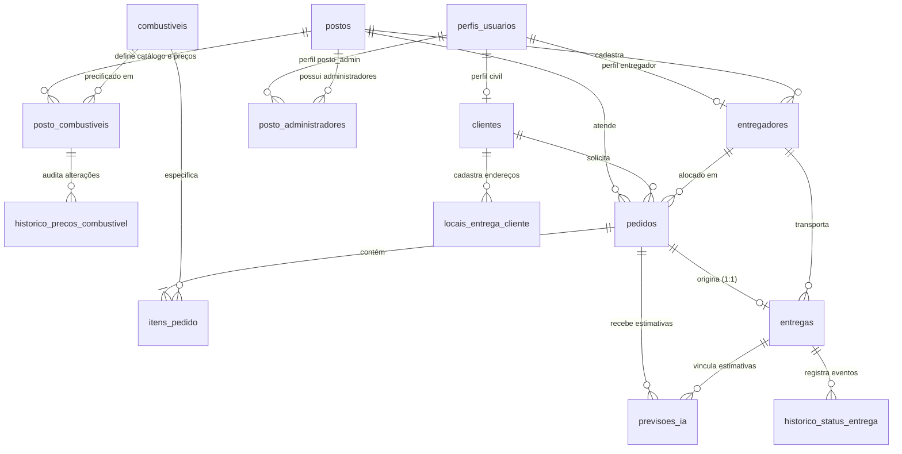

# Dicionário de Dados e Arquitetura do Banco de Dados: Fuel-Sync

Este documento descreve a modelagem relacional, constraints, índices e o dicionário de dados do banco de dados da plataforma Fuel-Sync (PostgreSQL / Supabase).

---

## 1. Visão Geral da Modelagem

O modelo de dados foi projetado para operações **B2C (consumidores civis, marinas, geradores em condomínios e chácaras)** com ciclo logístico fechado **Posto -> Cliente -> Posto (Hub-and-Spoke)** e arquitetura **multi-tenant** com precificação descentralizada por posto.

---

## 2. Dicionário de Dados das Tabelas

### 2.1 `perfis_usuarios`
Armazena a referência de perfil vinculada à conta autenticada no Supabase Auth (`auth.users`).

| Coluna | Tipo | Constraints | Descrição |
| :--- | :--- | :--- | :--- |
| `id` | `UUID` | `PRIMARY KEY` | Identificador do usuário emitido pelo Supabase Auth |
| `email` | `VARCHAR(150)` | `NOT NULL, UNIQUE` | E-mail corporativo ou pessoal |
| `nome` | `VARCHAR(120)` | `NOT NULL` | Nome completo do usuário |
| `role` | `VARCHAR(20)` | `NOT NULL, CHECK (cliente, posto_admin, entregador, admin_geral)` | Papel de acesso no sistema (RBAC) expandido na migração 002 |
| `created_at` | `TIMESTAMP WITH TIME ZONE` | `DEFAULT CURRENT_TIMESTAMP` | Data e hora de criação |

---

### 2.2 `postos`
Representa os postos de abastecimento parceiros que preparam e despacham o combustível.

| Coluna | Tipo | Constraints | Descrição |
| :--- | :--- | :--- | :--- |
| `id` | `SERIAL` | `PRIMARY KEY` | Identificador sequencial do posto |
| `nome_fantasia` | `VARCHAR(150)` | `NOT NULL` | Nome comercial do posto |
| `razao_social` | `VARCHAR(150)` | | Razão social fiscal |
| `cnpj` | `VARCHAR(18)` | `NOT NULL, UNIQUE` | Cadastro Nacional da Pessoa Jurídica |
| `telefone` | `VARCHAR(20)` | `NOT NULL` | Telefone de contato operacional |
| `endereco` | `VARCHAR(255)` | `NOT NULL` | Endereço físico da base/posto |
| `latitude` | `DECIMAL(9,6)` | `NOT NULL, CHECK (-90 a 90)` | Coordenada de latitude da base |
| `longitude` | `DECIMAL(9,6)` | `NOT NULL, CHECK (-180 a 180)` | Coordenada de longitude da base |
| `tempo_medio_preparo_minutos` | `INTEGER` | `DEFAULT 12, CHECK (>= 0)` | Tempo padrão de carregamento e conferência no posto |
| `ativo` | `BOOLEAN` | `DEFAULT TRUE` | Flag de disponibilidade operacional do posto |
| `created_at` | `TIMESTAMP WITH TIME ZONE` | `DEFAULT CURRENT_TIMESTAMP` | Registro de data de criação |

---

### 2.3 `clientes`
Consumidores civis cadastrados para solicitar abastecimento fracionado.

| Coluna | Tipo | Constraints | Descrição |
| :--- | :--- | :--- | :--- |
| `id` | `SERIAL` | `PRIMARY KEY` | Identificador sequencial do cliente |
| `usuario_id` | `UUID` | `UNIQUE` | Vínculo opcional com `perfis_usuarios(id)` |
| `nome` | `VARCHAR(120)` | `NOT NULL` | Nome completo do cliente |
| `cpf` | `VARCHAR(14)` | `NOT NULL, UNIQUE` | Cadastro de Pessoa Física |
| `email` | `VARCHAR(150)` | `NOT NULL, UNIQUE` | E-mail para notificações e faturamento |
| `telefone` | `VARCHAR(20)` | `NOT NULL` | WhatsApp / Telefone para aviso de entrega |
| `endereco_padrao` | `VARCHAR(255)` | | Endereço habitual de entrega |
| `ponto_referencia_padrao` | `VARCHAR(150)` | | Exemplo: "Marina da Glória, Píer B, Vaga 14" |
| `latitude` | `DECIMAL(9,6)` | `CHECK (-90 a 90)` | Latitude padrão do local de entrega |
| `longitude` | `DECIMAL(9,6)` | `CHECK (-180 a 180)` | Longitude padrão do local de entrega |
| `created_at` | `TIMESTAMP WITH TIME ZONE` | `DEFAULT CURRENT_TIMESTAMP` | Data de cadastro |

---

### 2.4 `entregadores`
Condutores credenciados pelo posto operando veículos leves/utilitários homologados.

| Coluna | Tipo | Constraints | Descrição |
| :--- | :--- | :--- | :--- |
| `id` | `SERIAL` | `PRIMARY KEY` | Identificador sequencial do entregador |
| `usuario_id` | `UUID` | `UNIQUE` | Vínculo com a conta de autenticação |
| `posto_id` | `INTEGER` | `NOT NULL, REFERENCES postos(id)` | Posto ao qual o entregador está vinculado |
| `nome` | `VARCHAR(120)` | `NOT NULL` | Nome do condutor |
| `cpf` | `VARCHAR(14)` | `NOT NULL, UNIQUE` | CPF do condutor |
| `telefone` | `VARCHAR(20)` | `NOT NULL` | Telefone celular do entregador |
| `veiculo_descricao` | `VARCHAR(80)` | `NOT NULL` | Descrição do utilitário com tanques homologados |
| `placa` | `VARCHAR(10)` | `NOT NULL` | Placa do veículo |
| `status` | `VARCHAR(30)` | `CHECK (DISPONIVEL, EM_ROTA, INDISPONIVEL)` | Status de disponibilidade operacional |
| `ultima_latitude` | `DECIMAL(9,6)` | `CHECK (-90 a 90)` | Posição recente para monitoramento de rota |
| `ultima_longitude` | `DECIMAL(9,6)` | `CHECK (-180 a 180)` | Posição recente para monitoramento de rota |
| `ultima_posicao_em` | `TIMESTAMP WITH TIME ZONE` | | Timestamp da última coordenada registrada |
| `created_at` | `TIMESTAMP WITH TIME ZONE` | `DEFAULT CURRENT_TIMESTAMP` | Data de cadastro |

---

### 2.5 `combustiveis`
Catálogo global de produtos combustíveis disponíveis para entrega civil.

| Coluna | Tipo | Constraints | Descrição |
| :--- | :--- | :--- | :--- |
| `id` | `SERIAL` | `PRIMARY KEY` | Identificador do combustível |
| `nome` | `VARCHAR(50)` | `NOT NULL, UNIQUE` | Nome comercial (ex: Gasolina Podium, Diesel Náutico S10) |
| `unidade_medida` | `VARCHAR(10)` | `NOT NULL, DEFAULT 'LITROS'` | Unidade padrão de medida |

---

### 2.6 `pedidos`
Cabeçalho das solicitações de abastecimento feitas pelos clientes civis.

| Coluna | Tipo | Constraints | Descrição |
| :--- | :--- | :--- | :--- |
| `id` | `SERIAL` | `PRIMARY KEY` | Número do pedido |
| `cliente_id` | `INTEGER` | `NOT NULL, REFERENCES clientes(id)` | Cliente solicitante |
| `posto_id` | `INTEGER` | `NOT NULL, REFERENCES postos(id)` | Posto responsável pelo fornecimento |
| `entregador_id` | `INTEGER` | `REFERENCES entregadores(id) ON DELETE SET NULL` | Condutor/entregador alocado para o despacho (obrigatório para status `EM_TRANSPORTE`, migração 005) |
| `status` | `VARCHAR(30)` | `CHECK (PENDENTE, CONFIRMADO_POSTO, EM_PREPARACAO, EM_TRANSPORTE, CONCLUIDO, CANCELADO)` | Estado do ciclo de vida do pedido |
| `valor_total` | `DECIMAL(12,2)` | `NOT NULL, CHECK (>= 0)` | Valor total acumulado dos itens |
| `endereco_entrega` | `VARCHAR(255)` | `NOT NULL` | Local onde o abastecimento ocorrerá |
| `ponto_referencia` | `VARCHAR(150)` | | Píer, vaga, ramal ou condomínio |
| `tipo_local` | `VARCHAR(30)` | `CHECK (MARINA, CONDOMINIO, CHACARA, RODOVIA, RESIDENCIA, OUTRO)` | Classificação operacional do local civil |
| `instrucoes_adicionais` | `TEXT` | | Orientações de acesso para o entregador |
| `destino_latitude` | `DECIMAL(9,6)` | `NOT NULL, CHECK (-90 a 90)` | Coordenada exata do destino |
| `destino_longitude` | `DECIMAL(9,6)` | `NOT NULL, CHECK (-180 a 180)` | Coordenada exata do destino |
| `horario_previsto_entrega` | `TIMESTAMP WITH TIME ZONE` | | Marco oficial de estimativa de entrega (baseline) fixado no aceite pelo posto (migração 007) |
| `tempo_estimado_entrega_minutos` | `INTEGER` | `CHECK (>= 0)` | Duração total estimada em minutos no momento da confirmação (baseline, migração 007) |
| `data_pedido` | `TIMESTAMP WITH TIME ZONE` | `DEFAULT CURRENT_TIMESTAMP` | Data de emissão |

---

### 2.7 `itens_pedido`
Detalhamento de volume e tipo de combustível do pedido.

| Coluna | Tipo | Constraints | Descrição |
| :--- | :--- | :--- | :--- |
| `id` | `SERIAL` | `PRIMARY KEY` | Identificador do item |
| `pedido_id` | `INTEGER` | `NOT NULL, REFERENCES pedidos(id) ON DELETE CASCADE` | Pedido correspondente |
| `combustivel_id` | `INTEGER` | `NOT NULL, REFERENCES combustiveis(id)` | Tipo de combustível solicitado |
| `quantidade_litros` | `DECIMAL(10,2)` | `NOT NULL, CHECK (> 0)` | Volume solicitado em litros |
| `valor_unitario` | `DECIMAL(8,3)` | `NOT NULL, CHECK (>= 0)` | Preço por litro praticado pelo posto |
| `subtotal` | `DECIMAL(12,2)` | `NOT NULL, CHECK (>= 0)` | Volume multiplicado pelo valor unitário |

---

### 2.8 `entregas`
Representa a execução física da entrega seguindo o ciclo Posto-Cliente-Posto.

| Coluna | Tipo | Constraints | Descrição |
| :--- | :--- | :--- | :--- |
| `id` | `SERIAL` | `PRIMARY KEY` | Identificador da entrega |
| `pedido_id` | `INTEGER` | `NOT NULL, UNIQUE, REFERENCES pedidos(id)` | Relação 1:1 com o pedido |
| `entregador_id` | `INTEGER` | `NOT NULL, REFERENCES entregadores(id)` | Condutor responsável pela viagem |
| `ordem_na_fila` | `INTEGER` | `NOT NULL, DEFAULT 1, CHECK (>= 1)` | Posição na fila de entregas do entregador |
| `status_entrega` | `VARCHAR(35)` | `CHECK (AGENDADO, EM_OUTRA_ENTREGA, PREPARANDO_POSTO, A_CAMINHO, NO_LOCAL_ABASTECENDO, RETORNANDO_AO_POSTO, CONCLUIDO, FALHA_CANCELADO)` | Etapa atual do ciclo |
| `data_inicio_preparo` | `TIMESTAMP WITH TIME ZONE` | | Início da carga no posto |
| `data_saida_posto` | `TIMESTAMP WITH TIME ZONE` | | Saída do posto rumo ao cliente |
| `data_chegada_local` | `TIMESTAMP WITH TIME ZONE` | | Chegada à marina/local |
| `data_inicio_retorno` | `TIMESTAMP WITH TIME ZONE` | | Fim do abastecimento e partida para o posto |
| `data_retorno_posto` | `TIMESTAMP WITH TIME ZONE` | | Chegada à base / conclusão do ciclo |
| `tempo_estimado_atendimento_min` | `INTEGER` | `DEFAULT 20, CHECK (>= 0)` | Tempo previsto para operação no local |

---

### 2.9 `previsoes_ia`
Registros das estimativas inteligentes geradas pelo motor preditivo de IA (Groq Cloud LPU e telemetria).

| Coluna | Tipo | Constraints | Descrição |
| :--- | :--- | :--- | :--- |
| `id` | `BIGSERIAL` | `PRIMARY KEY` | Identificador da previsão |
| `pedido_id` | `BIGINT` | `REFERENCES pedidos(id) ON DELETE CASCADE` | Vínculo direto ao pedido, permitindo estimativas antes da geração do registro em `entregas` (migração 006) |
| `entrega_id` | `INTEGER` | `REFERENCES entregas(id) ON DELETE CASCADE` | Entrega vinculada (opcional pós-migração 006) |
| `eta_previsto` | `TIMESTAMP WITH TIME ZONE` | `NOT NULL` | Horário estimado de chegada ao local do cliente |
| `tempo_espera_liberacao_minutos` | `INTEGER` | `DEFAULT 0, CHECK (>= 0)` | Tempo restante da entrega anterior + retorno ao posto |
| `tempo_preparo_posto_minutos` | `INTEGER` | `DEFAULT 12, CHECK (>= 0)` | Tempo de carregamento deste pedido no posto |
| `tempo_viagem_cliente_minutos` | `INTEGER` | `DEFAULT 0, CHECK (>= 0)` | Deslocamento rodoviário/naval do posto até o cliente |
| `confianca_score` | `DECIMAL(5,4)` | `CHECK (0 a 1)` | Nível de precisão da estimativa estatística/cognitiva |
| `risco_atraso` | `BOOLEAN` | `DEFAULT FALSE` | Indicador de risco iminente de desvio operacional |
| `fator_principal_risco` | `VARCHAR(255)` | | Fator causal (ex: `DEMORA_PARADA_ANTERIOR`, `TRANSITO`, tamanho expandido na migração 006) |
| `mensagem_humanizada` | `TEXT` | `NOT NULL` | Texto explicativo claro exibido no aplicativo do cliente |
| `criado_em` | `TIMESTAMP WITH TIME ZONE` | `DEFAULT CURRENT_TIMESTAMP` | Data e hora do cálculo preditivo |

---

### 2.10 `historico_status_entrega`
Registro imutável de auditoria de cada evento de avanço ou alteração da entrega.

| Coluna | Tipo | Constraints | Descrição |
| :--- | :--- | :--- | :--- |
| `id` | `BIGSERIAL` | `PRIMARY KEY` | Identificador sequencial do log |
| `entrega_id` | `INTEGER` | `NOT NULL, REFERENCES entregas(id) ON DELETE CASCADE` | Entrega relacionada |
| `status_anterior` | `VARCHAR(35)` | | Status prévio à transição |
| `status_novo` | `VARCHAR(35)` | `NOT NULL` | Novo status estabelecido |
| `descricao_motivo` | `VARCHAR(255)` | | Justificativa ou detalhe do evento |
| `origem_alteracao` | `VARCHAR(30)` | `CHECK (ENTREGADOR_APP, POSTO_WEB, SISTEMA_IA, CLIENTE_APP)` | Canal que acionou a mudança |
| `latitude_momento` | `DECIMAL(9,6)` | `CHECK (-90 a 90)` | Coordenada no instante do check-in |
| `longitude_momento` | `DECIMAL(9,6)` | `CHECK (-180 a 180)` | Coordenada no instante do check-in |
| `criado_em` | `TIMESTAMP WITH TIME ZONE` | `NOT NULL, DEFAULT CURRENT_TIMESTAMP` | Momento exato da transição |

---

### 2.11 `posto_administradores`
Vinculação multi-tenant entre administradores de posto (`posto_admin`) e as unidades parceiras (`postos`). (Migração 002).

| Coluna | Tipo | Constraints | Descrição |
| :--- | :--- | :--- | :--- |
| `id` | `UUID` | `PRIMARY KEY, DEFAULT gen_random_uuid()` | Identificador único da permissão de vínculo |
| `user_id` | `UUID` | `NOT NULL` | Identificador do usuário no Supabase Auth (`perfis_usuarios.id`) |
| `posto_id` | `INTEGER` | `NOT NULL, REFERENCES postos(id) ON DELETE CASCADE` | Posto sob gestão do administrador |
| `criado_em` | `TIMESTAMP WITH TIME ZONE` | `DEFAULT CURRENT_TIMESTAMP` | Data e hora da associação |

*Constraint única:* `uq_posto_admin_link (user_id, posto_id)`

---

### 2.12 `posto_combustiveis`
Catálogo de precificação independente e saldo de estoque por combustível para cada posto parceiro. (Migração 002).

| Coluna | Tipo | Constraints | Descrição |
| :--- | :--- | :--- | :--- |
| `id` | `UUID` | `PRIMARY KEY, DEFAULT gen_random_uuid()` | Identificador único do registro de preço/estoque |
| `posto_id` | `INTEGER` | `NOT NULL, REFERENCES postos(id) ON DELETE CASCADE` | Posto fornecedor |
| `combustivel_id` | `INTEGER` | `NOT NULL, REFERENCES combustiveis(id) ON DELETE CASCADE` | Combustível precificado |
| `preco_litro` | `NUMERIC(10,2)` | `NOT NULL, CHECK (preco_litro > 0)` | Preço por litro praticado pelo posto |
| `estoque_litros` | `NUMERIC(12,2)` | `NOT NULL, DEFAULT 0.00, CHECK (estoque_litros >= 0)` | Saldo de combustível disponível nos tanques da base |
| `disponivel` | `BOOLEAN` | `NOT NULL, DEFAULT TRUE` | Flag de disponibilidade para novos pedidos |
| `atualizado_em` | `TIMESTAMP WITH TIME ZONE` | `DEFAULT CURRENT_TIMESTAMP` | Data da última alteração de preço ou estoque |
| `atualizado_por` | `UUID` | | Usuário responsável pela atualização |

*Constraint única:* `uq_posto_combustivel_preco (posto_id, combustivel_id)`

---

### 2.13 `historico_precos_combustivel`
Auditoria automatizada via trigger nativa do PostgreSQL (`trg_audit_preco_combustivel`) para rastreamento de flutuação de preços por posto. (Migração 002).

| Coluna | Tipo | Constraints | Descrição |
| :--- | :--- | :--- | :--- |
| `id` | `UUID` | `PRIMARY KEY, DEFAULT gen_random_uuid()` | Identificador do registro de auditoria |
| `posto_combustivel_id` | `UUID` | `REFERENCES posto_combustiveis(id) ON DELETE SET NULL` | Registro original da precificação |
| `posto_id` | `INTEGER` | `NOT NULL, REFERENCES postos(id) ON DELETE CASCADE` | Posto associado |
| `combustivel_id` | `INTEGER` | `NOT NULL, REFERENCES combustiveis(id) ON DELETE CASCADE` | Combustível que sofreu alteração |
| `preco_anterior` | `NUMERIC(10,2)` | | Preço anterior à modificação (NULL na inclusão inicial) |
| `preco_novo` | `NUMERIC(10,2)` | `NOT NULL, CHECK (preco_novo > 0)` | Novo preço por litro registrado |
| `alterado_em` | `TIMESTAMP WITH TIME ZONE` | `DEFAULT CURRENT_TIMESTAMP` | Momento exato da alteração tarifária |
| `alterado_por` | `UUID` | | Usuário que executou a modificação |

---

### 2.14 `locais_entrega_cliente`
Múltiplos locais e pontos de abastecimento cadastrados pelos clientes civis (marinas, trapiches, ramais e condomínios). (Migração 003).

| Coluna | Tipo | Constraints | Descrição |
| :--- | :--- | :--- | :--- |
| `id` | `SERIAL` | `PRIMARY KEY` | Identificador sequencial do local de entrega |
| `cliente_id` | `INTEGER` | `NOT NULL, REFERENCES clientes(id) ON DELETE CASCADE` | Cliente titular do endereço |
| `apelido` | `VARCHAR(120)` | `NOT NULL` | Identificador descritivo (ex: "Marina da Glória - Vaga 14", "Trapiche Principal") |
| `tipo_local` | `VARCHAR(30)` | `NOT NULL, CHECK (tipo_local IN ('MARINA', 'CONDOMINIO', 'CHACARA', 'RODOVIA', 'RESIDENCIA', 'OUTRO'))` | Classificação operacional do local civil |
| `endereco` | `VARCHAR(255)` | `NOT NULL` | Endereço ou referência geográfica textual |
| `ponto_referencia` | `VARCHAR(150)` | | Píer, vaga, atracadouro ou orientações de acesso |
| `latitude` | `DECIMAL(9,6)` | `NOT NULL, CHECK (latitude BETWEEN -90 AND 90)` | Coordenada geográfica de latitude |
| `longitude` | `DECIMAL(9,6)` | `NOT NULL, CHECK (longitude BETWEEN -180 AND 180)` | Coordenada geográfica de longitude |
| `padrao` | `BOOLEAN` | `DEFAULT FALSE` | Indicador se este é o local de entrega padrão do cliente |
| `created_at` | `TIMESTAMP WITH TIME ZONE` | `DEFAULT CURRENT_TIMESTAMP` | Data e hora de criação |

---

## 3. Índices de Otimização de Consultas

1. `idx_entregas_fila`: `(entregador_id, status_entrega, ordem_na_fila)` — Tabela `entregas`
   - Otimiza a recuperação da fila ativa do entregador e a automação do próximo cliente a ser preparado.
2. `idx_previsoes_entrega`: `(entrega_id, criado_em DESC)` — Tabela `previsoes_ia`
   - Otimiza a consulta imediata da previsão de ETA mais recente por entrega para exibição no aplicativo do cliente civil.
3. `idx_historico_entrega`: `(entrega_id, criado_em DESC)` — Tabela `historico_status_entrega`
   - Otimiza a linha do tempo e auditoria da entrega.
4. `idx_posto_administradores_user`: `(user_id)` — Tabela `posto_administradores` (Migração 002)
   - Agiliza a verificação de permissões do usuário autenticado sobre seus postos vinculados.
5. `idx_posto_administradores_posto`: `(posto_id)` — Tabela `posto_administradores` (Migração 002)
   - Otimiza a listagem de administradores por unidade de posto.
6. `idx_posto_combustiveis_posto`: `(posto_id)` — Tabela `posto_combustiveis` (Migração 002)
   - Acelera a consulta do catálogo e tabela de preços por posto.
7. `idx_posto_combustiveis_combustivel`: `(combustivel_id)` — Tabela `posto_combustiveis` (Migração 002)
   - Agiliza a busca de postos que comercializam determinado combustível.
8. `idx_hist_precos_posto_combustivel`: `(posto_id, combustivel_id, alterado_em DESC)` — Tabela `historico_precos_combustivel` (Migração 002)
   - Otimiza o histórico temporal de auditoria tarifária por combustível de cada posto.
9. `idx_locais_entrega_cliente_id`: `(cliente_id)` — Tabela `locais_entrega_cliente` (Migração 003)
   - Acelera a recuperação de endereços salvos pelo cliente autenticado no fluxo de compra.
10. `idx_pedidos_entregador_id`: `(entregador_id)` — Tabela `pedidos` (Migração 005)
    - Otimiza o despacho e a listagem de pedidos designados a um entregador específico.
11. `idx_previsoes_pedido`: `(pedido_id, criado_em DESC)` — Tabela `previsoes_ia` (Migração 006)
    - Agiliza a consulta direta da previsão preditiva associada ao pedido antes ou durante o transporte.
12. `idx_pedidos_posto_status`: `(posto_id, status)` — Tabela `pedidos` (Migração 007)
    - Otimiza as contagens e visualizações de pedidos em fila de espera (`PENDENTE`, `CONFIRMADO_POSTO`, `EM_PREPARACAO`) por posto.
