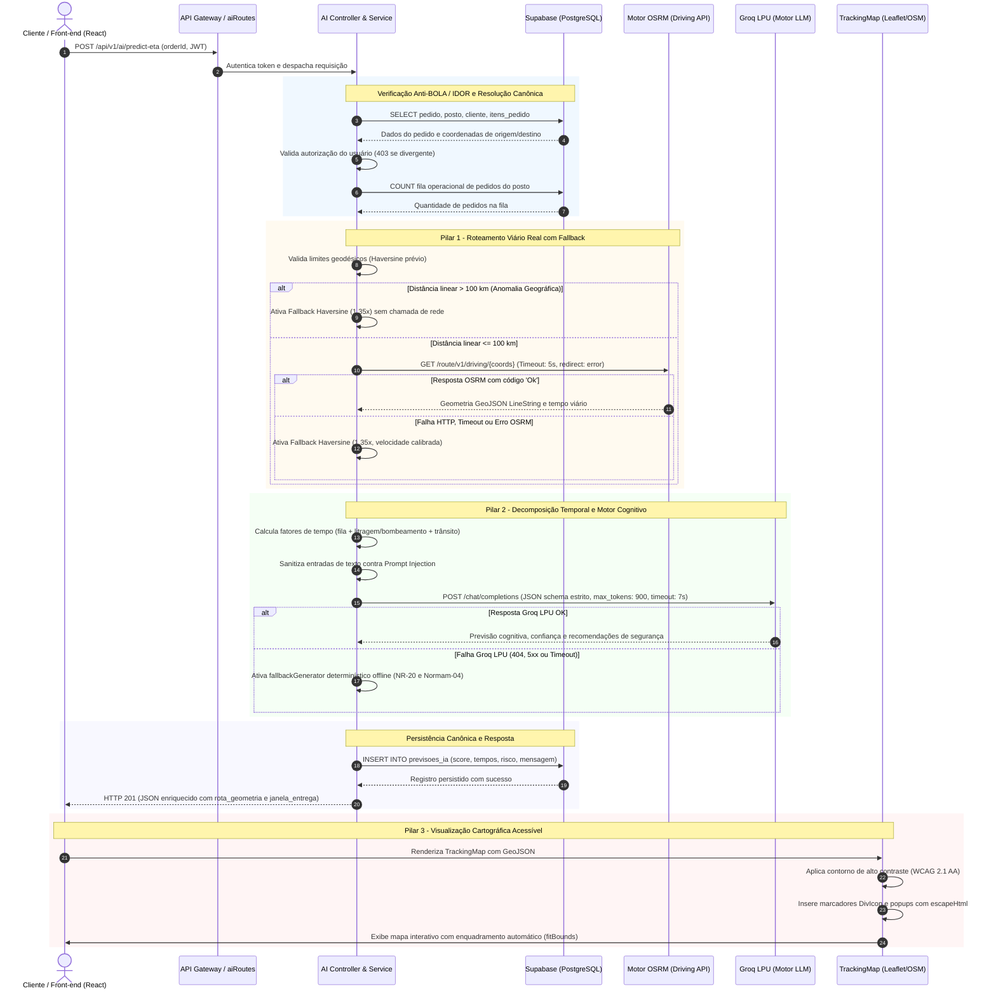

# ADR 008: Roteamento Real com OSRM e Motor Cognitivo de IA Operacional

## Status
ACEITO

## Data
2026-11-03

## Contexto e Forças

A plataforma NAVROTAS (FuelSync) atua na cadeia logística crítica de abastecimento e distribuição de combustíveis fracionados em ambientes urbanos, rurais e marítimo-costeiros (postos de serviço, piers, marinas, atracadouros, geradores e indústrias). 

Historicamente, o subsistema de previsão de tempo estimado de entrega (ETA) apresentava severas deficiências operacionais e técnicas:
1. **Cálculo Geodésico Ingênuo (Linha Reta):** A distância entre o posto e o destino era calculada puramente pela fórmula de Haversine ou distância euclidiana multiplicada por uma velocidade hipotética. Em zonas costeiras e regiões com canais náuticos ou malha viária fragmentada, a distância linear subestimava o trajeto real em até 80%, resultando em estimativas de chegada irreais para clientes e frotas de entrega.
2. **Predições Rasas e Genéricas de IA:** As respostas geradas por IA limitavam-se a frases de saudação sem utilidade analítica, desprovidas de contexto sobre o estado operacional do pedido, ignorando o tempo de bombeamento de combustível (litragem solicitada), o tempo de fila no posto e os riscos de segurança específicos do local de entrega.
3. **Ausência de Rastreamento Visual da Rota:** O usuário visualizava apenas coordenadas estáticas ou linhas retas sem aderência às vias públicas navegáveis, gerando desconfiança e ligações de suporte.
4. **Resiliência e Continuidade Operacional:** Modelos LLM e serviços externos de roteamento estão sujeitos a indisponibilidades, picos de latência e limites de taxa (*rate limiting*). Uma falha em um provedor externo não pode interromper a jornada do pedido.
5. **Vulnerabilidades de Segurança Identificadas:**
   - **BOLA / IDOR (*Broken Object Level Authorization*):** O endpoint de predição permitia que qualquer usuário autenticado inspecionasse dados operacionais e de localização de pedidos pertencentes a outros clientes ou postos.
   - **XSS (*Cross-Site Scripting*):** Inserção de dados não sanitizados em popups HTML de mapas interativos.
   - **Prompt Injection:** Interpolação direta de campos controlados pelo usuário (como contratempos e pontos de referência) nos prompts de IA.
   - **SSRF (*Server-Side Request Forgery*):** Possibilidade de redirecionamento malicioso ou resolução de endereços de metadados internos da nuvem (`169.254.169.254`) em requisições de roteamento.

---

## Decisão Técnica Tomada

Adotou-se uma arquitetura híbrida de quatro pilares combinando roteamento viário/marítimo real de alta performance, inteligência artificial cognitiva contextualizada com fallback determinístico instantâneo, visualização cartográfica geoespacial acessível e endurecimento integral de segurança.

```
+---------------------------------------------------------------------------------------------------+
|                                 ARQUITETURA DE 4 PILARES NAVROTAS                                 |
+---------------------------------+---------------------------------+-------------------------------+
| 1. Roteamento Real OSRM         | 2. IA Cognitiva & Operacional   | 3. Visualização Leaflet/OSM   |
| - Protocolo GeoJSON Driving     | - Groq LPU (Llama / GPT-OSS)    | - Polyline Contorno WCAG 2.1  |
| - Timeout 5000ms via AbortCtrl  | - Decomposição Fila/Preparo/Rota| - DivIcon Semântico SVG       |
| - Fallback Haversine 1.35x      | - Normas NR-20 / Normam-04/DPC  | - Sanitização XSS em Popups   |
+---------------------------------+---------------------------------+-------------------------------+
| 4. Hardening de Segurança: Anti-BOLA/IDOR | Sanitização Prompt | Anti-SSRF (redirect: error)      |
+---------------------------------------------------------------------------------------------------+
```

### 1. Roteamento Real com OSRM e Fallback Determinístico de Haversine

O cliente `routingClient.js` implementa a comunicação com o motor Open Source Routing Machine (OSRM):
- **Resolução de Geometria:** Utiliza o endpoint `/route/v1/driving/{lon1},{lat1};{lon2},{lat2}?overview=full&geometries=geojson`, extraindo distância real em metros e duração em segundos convertida para minutos.
- **Resiliência e Timeout Defensivo:** Requisições protegidas com timeout estrito de **5000 ms** via `AbortController` nativo do Node.js 20+.
- **Guardrail de Anomalia Geográfica:** Antes de disparar qualquer tráfego de rede, a distância geodésica linear é calculada via Haversine. Caso exceda o raio operacional máximo de **100 km** (`MAX_OPERATIONAL_RADIUS_KM`), a requisição externa ao OSRM é abortada imediatamente, sinalizando anomalia geográfica para prevenir requisições inúteis e fraudes.
- **Fallback Determinístico Instantâneo:** Se o OSRM estiver inacessível, retornar HTTP >= 400 ou expirar o timeout, o sistema ativa o cálculo determinístico baseado em Haversine multiplicado pelo coeficiente de tortuosidade viária/náutica (`ROUTING_TORTUOSITY_FACTOR = 1.35x`). A velocidade média estimada é calibrada por tipo de destinação (30 km/h para vias terrestres urbanas; 20 km/h para destinos como MARINA, PONTÃO ou CHÁCARA).

### 2. IA Cognitiva Operacional, Decomposição de Tempos e Normas Técnicas

O subsistema de cálculo (`etaCalculator.js` e `groqClient.js`) decompõe a estimativa em fatores reais de operação:
- **Decomposição Temporal por Fase do Pedido:**
  * **Status `PENDENTE` (Fase `ACEITE`):** O tempo estimado compreende o aceite do operador do posto, modelado pela quantidade de pedidos pendentes na fila daquele posto específico (~4 minutos adicionais por pedido na fila).
  * **Status `CONFIRMADO_POSTO`:** Estabelece e persiste no banco de dados o *baseline* inicial acordado de entrega. Totaliza o tempo de fila de carregamento no posto (~12 minutos por pedido ativo), tempo de preparo/bombeamento e tempo de trânsito.
  * **Status `EM_PREPARACAO`:** Zera a fila de confirmação inicial e calcula o preparo restante considerando a litragem do pedido (taxa de bombeamento industrial) somado ao tempo de trânsito em rota.
  * **Status `EM_TRANSPORTE`:** Considera estritamente o tempo de viagem residual ao longo da geometria traçada pelo entregador.
- **Janela de Entrega Probabilística:** O campo `janela_entrega` (`inicio`, `fim`, `formato_amigavel`) calcula a margem de variabilidade operacional conforme a duração do percurso, formatada no fuso horário do sistema (`APP_TIMEZONE = America/Sao_Paulo`).
- **Diretrizes Normativas de Segurança:**
  * **NR-20 (Líquidos Inflamáveis e Combustíveis):** Protocolos obrigatórios de isolamento de área com cones/fita zebrada, aterramento estático contra faíscas, extintores de incêndio portáteis adequados (Pó Químico Seco PQS classe BC ou CO2) e operador dedicado para vazões superiores a 500 litros.
  * **Normam-04/DPC (Diretoria de Portos e Costas - Marinha do Brasil):** Desligamento mandatário de motores marítimos, geradores e circuitos de bordo em marinas e piers, equalização eletrostática do bocal da embarcação e kit de mitigação com mantas absorventes para contenção de hidrocarbonetos na linha d'água.
- **Motor LLM com Fallback Offline:** Processamento via Groq Cloud LPU com modelo padrão `openai/gpt-oss-120b`, fallback transparente de modelo para `llama-3.1-8b-instant` em caso de erro 404, e fallback determinístico offline (`fallbackGenerator.js`) caso a IA esteja inoperante, mantendo o SLA de resposta abaixo de 3 segundos em 100% dos cenários.

### 3. Visualização Geoespacial Acessível com Leaflet e OpenStreetMap

No front-end SPA React, o componente `TrackingMap.jsx` entrega renderização vetorial sem dependência de chaves de API pagas:
- **Camada Base:** OpenStreetMap com atribuição legal de copyright.
- **Marcadores Semânticos:** Implementados via `L.divIcon` com SVG vetorial embutido e diferenciação de cores de alto contraste:
  * Posto Credenciado de Origem: Círculo Índigo (`#4f46e5`) com ícone de bomba de combustível.
  * Destino do Cliente: Círculo Esmeralda (`#059669`) com ícone de pin geográfico.
  * Entregador: Círculo Azul (`#2563eb`) com anel pulsante animado CSS (`animate-ping`) ativo exclusivamente durante o status `EM_TRANSPORTE`.
- **Contraste de Polyline em Conformidade com WCAG 2.1 AA:** O traçado do percurso é desenhado com uma camada dupla: uma linha de base branca espessa (`weight: 7`, contorno) sob a linha principal azul (`weight: 4`), garantindo legibilidade nítida sobre áreas urbanas densas, rios e rodovias do mapa. Em caso de projeção de fallback (Haversine), a linha adota estilo tracejado (`dashArray: '6, 6'`).
- **Acessibilidade e Usabilidade:** O container e a barra de status possuem atributos ARIA (`role="region"`, `aria-label`), botão de recentralização automática (`fitBounds` com padding protetor) e exibição de badges informativas (`Rota Real OSRM` vs. `Projeção Direta`).

### 4. Hardening de Segurança em Profundidade

- **Controle de Acesso Baseado em Objeto (Anti-BOLA/IDOR):** Na resolução de dados por `orderId` em `/predict-eta`, o serviço valida se o usuário autenticado (`req.user`) possui permissão legítima sobre o registro:
  * Perfis `cliente`: O `cliente_id` do pedido deve coincidir com o cadastro do usuário.
  * Perfis `entregador`: O pedido deve estar expressamente atribuído ao seu identificador (`entregador_id`).
  * Perfis `posto_admin`: O posto vinculado ao pedido deve ser administrado pelo usuário.
  * Perfil `admin_geral`: Acesso irrestrito de auditoria. Tentativas não autorizadas são bloqueadas com código `403 Forbidden`.
- **Prevenção de XSS em Mapas:** Todo conteúdo dinâmico inserido nos balões de popup do Leaflet passa pela função defensiva `escapeHtml()`, neutralizando vetores de injeção em nomes de postos, endereços ou operadores.
- **Higienização de Injeção de Prompt:** Entradas de texto livre (`customerName`, `stationName`, `setbackDescription`, `referencePoint`) são sanitizadas com remoção de caracteres de controle, quebras de linha e símbolos de escape (`\ " ' { } [ ]`), com truncamento estrito de comprimento.
- **Proteção contra SSRF no Roteador:** O cliente de roteamento valida estritamente a URL de destino, rejeita protocolos não HTTP/HTTPS, bloqueia consultas ao endereço de metadados de instâncias em nuvem (`169.254.169.254`) e configura o cabeçalho `redirect: 'error'` no `fetch` nativo para impedir desvios maliciosos.

---

## Diagrama Arquitetural de Sequência e Fluxo de Execução

O diagrama a seguir detalha o ciclo de vida completo de uma requisição de estimativa de entrega:



---

## Consequências da Decisão

### Positivas
- **Aderência Cartográfica e Realismo:** As rotas agora respeitam a malha viária navegável com distâncias fidedignas, acabando com discrepâncias geodésicas de percurso.
- **Previsibilidade Operacional e Segurança Jurídica:** Apresentação clara de janelas de entrega probabilísticas e decomposição de tempos (fila, bombeamento volumétrico e trânsito), reduzindo atrito com clientes.
- **Conformidade Normativa Exaustiva:** Adoção explícita das regras da NR-20 e Normam-04/DPC nos planos operacionais de abastecimento de combustíveis e áreas de marina.
- **Resiliência Extrema (Zero Single Point of Failure):** Sistema opera com 100% de disponibilidade em qualquer cenário de degradação externa (queda do OSRM ou Groq), degradando graciosamente para rotas de tortuosidade e templates determinísticos.
- **Proteção e Privacidade de Dados:** Eliminação de riscos de espionagem de pedidos de terceiros (BOLA), ataques de injeção em modelos de linguagem e explorações de rede interna (SSRF).
- **Sem Custos Recorrentes de Licenciamento de Mapas:** Adoção de Leaflet e OpenStreetMap elimina cobranças por visualizações de mapas em comparação a soluções proprietárias (Google Maps/Mapbox).

### Negativas e Compensações (Trade-offs)
- **Latência Cumulativa de Serviços Externos:** Chamadas sequenciais a serviços externos (OSRM + Groq) poderiam introduzir latência caso não fossem rigorosamente contidas. **Mitigação:** Timeouts calibrados de 5000 ms (OSRM) e 7000 ms (Groq) configurados em paralelo com AbortSignal garantem resiliência contra oscilações de rede sem travamentos indeterminados.
- **Uso do Servidor Público OSRM:** A instância pública `router.project-osrm.org` possui políticas de uso justo (*fair use*). **Mitigação:** Suporte a configuração de instância privada via variável de ambiente `OSRM_BASE_URL` para ambientes produtivos com alta volumetria.
- **Aproximação em Casos de Fallback:** O fator de tortuosidade de 1.35x é uma média geométrica que pode apresentar desvios menores em rotas com muitas curvas fechadas ou relevo acidentado. **Mitigação:** O front-end sinaliza transparentemente ao usuário a badge "Projeção Direta" em vez de "Rota Real OSRM".
